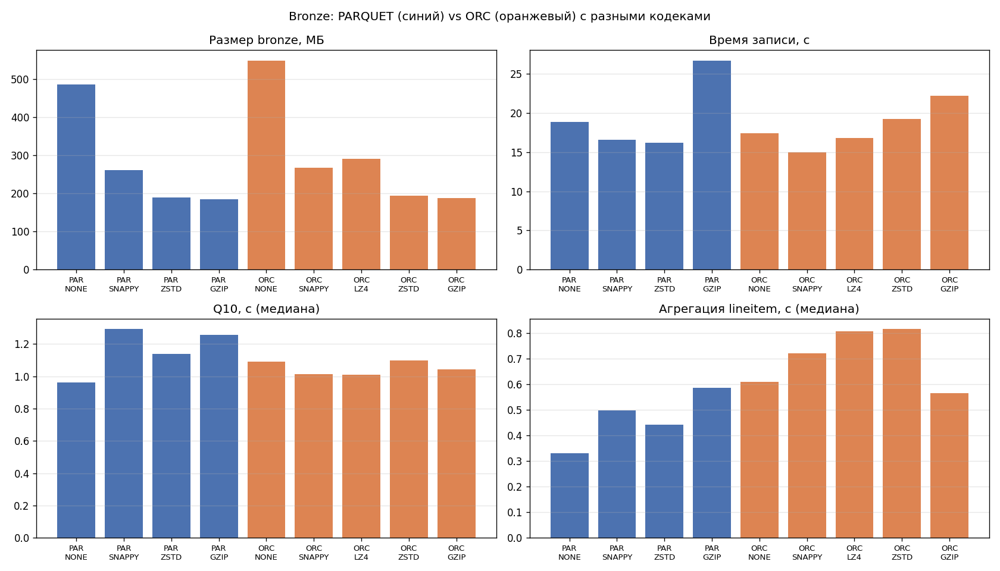

# Локальный Lakehouse: ELT по TPC-H Q10 и бенчмарк форматов/сжатия

Практическая работа №1. Вариант 2 — TPC-H Q10 «Returned Item Reporting»
(топ-20 клиентов по выручке от возвращённых позиций за 4 квартал 1993 года).

Заполненная форма отчёта с обоснованиями решений: [отчет.md](отчет.md).

## Стек

| Компонент | Версия | Порт | Роль |
|---|---|---|---|
| MinIO | latest | 9000 (S3), 9001 (консоль) | объектное хранилище, бакет `warehouse` |
| PostgreSQL | 17-alpine | — | БД метаданных Lakekeeper |
| Lakekeeper | v0.9.5 | 8181 | Iceberg REST Catalog, warehouse `lakehouse` |
| Trino | 476 | 8080 | SQL-движок, каталоги `lakehouse` (Iceberg) и `tpch` (генератор) |
| Spark | 3.5.3 + Iceberg 1.7.1 | — | второй движок, читает bronze через тот же каталог (профиль `spark`) |

```
tpch.sf1 (генератор в Trino)
      │  CTAS
      ▼
 bronze ──► silver ──► gold          Trino ──REST──► Lakekeeper ──► Postgres
 (сырые)   (очистка,   (витрины)       │                               
            обогащение)                └──── parquet / metadata ───► MinIO
                                     Spark ──REST──► Lakekeeper (те же таблицы)
```

## Структура

```
docker-compose.yml        весь стек
.env.example              логины/пароли для локального запуска
lakekeeper/               bootstrap каталога и описание warehouse
trino/                    конфиг Trino и каталоги lakehouse/tpch
sql/01_bronze.sql         загрузка сырых данных
sql/02_silver.sql         очистка, нормализация, обогащение
sql/03_gold.sql           витрины (ответ на Q10 + агрегат для дашборда)
sql/04_checks.sql         количество строк по слоям, сверка gold с эталоном
scripts/run_pipeline.py   прогон sql/01..04 с замером времени
scripts/layer_stats.py    строки / файлы / размер каждой таблицы
scripts/benchmark.py      бенчмарк форматов и кодеков на bronze
scripts/query_timing.py   время Q10 на bronze / silver / gold
scripts/evolution_time_travel.py   schema evolution + time travel + откат
spark/bronze_demo.py      чтение bronze из Spark
results/                  все полученные результаты
```

## Запуск

```bash
cp .env.example .env
docker compose up -d
```

После старта `lakekeeper-init` создаёт warehouse `lakehouse` поверх бакета `warehouse`.
Проверка: `docker exec -it trino trino --execute "SHOW SCHEMAS FROM lakehouse"`.

```bash
python3 -m venv .venv
.venv/bin/pip install -r requirements.txt
.venv/bin/python scripts/run_pipeline.py          # bronze -> silver -> gold -> проверки
.venv/bin/python scripts/layer_stats.py           # размеры слоёв
.venv/bin/python scripts/benchmark.py             # бенчмарк (~15 минут)
.venv/bin/python scripts/query_timing.py
.venv/bin/python scripts/evolution_time_travel.py
docker compose --profile spark run --rm spark     # Spark читает bronze
```

Масштаб задаётся переменной окружения `SF` (по умолчанию `sf1`), например `SF=sf3 python scripts/run_pipeline.py`.

## Медальон

**Bronze** — точная копия `tpch.sf1.{region, nation, customer, orders, lineitem}`, все колонки,
PARQUET + ZSTD, без партиций. Это неизменяемый «сырой» слой: если в silver найдётся ошибка,
его можно пересобрать без повторной загрузки из источника.

**Silver**:
- `silver.customer` — клиенты, дедуплицированные по `custkey`, строки обрезаны (`trim`),
  `acctbal` приведён к `decimal(15,2)`, добавлены `nation_name` и `region_name`;
- `silver.order_lines` — `lineitem ⋈ orders`: к каждой строке добавлены `custkey`,
  `orderdate`, `order_quarter`, `orderstatus` и посчитанная `net_revenue = extendedprice * (1 - discount)`;
  деньги в `decimal`, флаги в верхнем регистре, отброшены строки с пустыми ключами,
  ценой ≤ 0 и скидкой вне [0;1]. Партиционирование `year(orderdate)`, сортировка внутри файлов
  по `returnflag, orderdate`. Silver хранит все флаги возврата и все годы, т.е. подходит
  не только для Q10, но и для других запросов по заказам.

**Gold**:
- `gold.q10_returned_customers` — ответ на вариант (20 строк);
- `gold.returns_by_nation_quarter` — возвраты по регионам/странам/кварталам (350 строк) для дашборда.

Корректность: `sql/04_checks.sql` считает эталонный Q10 напрямую по генератору `tpch.sf1`
и сравнивает с gold — расхождений 0. Дополнительно Spark независимо считает Q10 по bronze
и тоже получает 0 расхождений с gold. Первая строка результата — `Customer#000057040`,
JAPAN, 734 235.25 — совпадает с опубликованным ответом TPC-H Q10 для SF1.

## Методология бенчмарка

Что сравнивается: 2 формата (PARQUET, ORC) × 5 кодеков (NONE, SNAPPY, LZ4, ZSTD, GZIP).
PARQUET + LZ4 Trino на запись не поддерживает (`Compression codec LZ4 not supported for Parquet`),
поэтому итоговых конфигураций 9.

Для каждой конфигурации:
1. в схеме `bench_<format>_<codec>` через CTAS пересоздаются bronze-таблицы
   `nation, customer, orders, lineitem` (всё, что нужно Q10). Источник — основной `lakehouse.bronze`,
   а не генератор tpch, чтобы генерация данных не съедала время записи;
2. **размер** — сумма `file_size_in_bytes` из метатаблицы Iceberg `"<table>$files"`
   (только data-файлы, без manifest/metadata);
3. **время записи** — суммарное wall-time всех CTAS;
4. **скорость агрегаций** — два запроса по 11 раз, первый прогон отбрасывается как прогрев, берётся медиана:
   - Q10 варианта (4 джойна + group by);
   - полный скан `lineitem` с агрегатами (в духе TPC-H Q1) — чистая нагрузка «прочитать и посчитать»;
5. таблицы удаляются.

Перед всеми замерами JVM Trino прогревается 5 прогонами запросов, иначе первые конфигурации
систематически медленнее из-за JIT (в первом пробном запуске это было хорошо заметно).
Весь набор прогоняется 3 раунда в случайном порядке, в таблицу идёт медиана по раундам
и разброс min..max. Сырые замеры — `results/benchmark_raw.csv`.

Окружение: MacBook (Apple Silicon, 10 ядер, 16 ГБ), Docker Desktop с лимитом 8 ГБ, Trino `-Xmx4G`,
один узел. MinIO локальный, поэтому сеть почти не влияет — это важно при интерпретации результатов.

## Результаты

Слои (`results/layer_stats.md`):

| Слой | Таблица | Строк | Файлов | Размер, МБ |
|---|---|---|---|---|
| bronze | customer | 150 000 | 1 | 7.80 |
| bronze | lineitem | 6 001 215 | 8 | 147.26 |
| bronze | nation | 25 | 1 | 0.002 |
| bronze | orders | 1 500 000 | 2 | 34.97 |
| bronze | region | 5 | 1 | 0.001 |
| silver | customer | 150 000 | 1* | 8.24* |
| silver | order_lines | 6 001 215 | 7 | 86.31 |
| gold | q10_returned_customers | 20 | 1 | 0.003 |
| gold | returns_by_nation_quarter | 350 | 1 | 0.006 |

\* до демонстрации schema evolution; после UPDATE/DELETE в таблице 3 файла (16.7 МБ) — старый файл
остаётся для time travel, пока не выполнен `expire_snapshots`.

Бенчмарк (`results/benchmark.md`, график `results/benchmark.png`):

| Формат | Кодек | Размер, МБ | Сжатие | Запись, с | Q10, с | Агрегация, с |
|---|---|---|---|---|---|---|
| PARQUET | NONE | 486.2 | x1.00 | 18.9 | 0.96 | 0.33 |
| PARQUET | SNAPPY | 261.3 | x1.86 | 16.6 | 1.29 | 0.50 |
| PARQUET | ZSTD | 190.2 | x2.56 | 16.2 | 1.14 | 0.44 |
| PARQUET | GZIP | 184.9 | x2.63 | 26.7 | 1.26 | 0.59 |
| ORC | NONE | 549.0 | x0.89 | 17.4 | 1.09 | 0.61 |
| ORC | SNAPPY | 267.7 | x1.82 | 15.0 | 1.01 | 0.72 |
| ORC | LZ4 | 290.4 | x1.67 | 16.8 | 1.01 | 0.81 |
| ORC | ZSTD | 193.7 | x2.51 | 19.2 | 1.10 | 0.82 |
| ORC | GZIP | 188.0 | x2.59 | 22.2 | 1.04 | 0.57 |



Время ответа на вопрос варианта на разных слоях (`results/query_timing.md`):

| Вариант | Медиана, с | Обработано строк | Прочитано, МБ |
|---|---|---|---|
| Q10 по bronze | 0.518 | 7 823 039 | 56.0 |
| Q10 по silver | 0.333 | 1 172 943 | 15.9 |
| чтение gold | 0.033 | 20 | 0.0 |

## Выводы по бенчмарку

- **Размер.** Сжатие даёт больше всего: ZSTD и GZIP уменьшают bronze в ~2.6 раза, SNAPPY/LZ4 — в ~1.7–1.9.
  Разница ZSTD и GZIP по размеру всего ~3%. Parquet без сжатия компактнее ORC без сжатия
  (486 против 549 МБ) за счёт словарного и RLE-кодирования, со сжатием форматы почти равны.
- **Запись.** GZIP самый медленный на запись (Parquet +65% к ZSTD). ZSTD пишет так же быстро,
  как SNAPPY, и при этом жмёт как GZIP.
- **Чтение.** На sf1 все варианты Q10 укладываются в 1.0–1.3 с, разброс между раундами
  сопоставим с разницей между кодеками — запрос упирается в джойны и CPU, а не в чтение
  (данные целиком в кэше ОС, MinIO локальный). На полном скане `lineitem` разница заметнее:
  Parquet в Trino быстрее ORC (0.33–0.59 с против 0.57–0.82 с, сравнялись только на GZIP),
  а внутри Parquet GZIP заметно медленнее ZSTD на декомпрессии (0.59 против 0.44 с).
  Несжатый Parquet читается быстрее всего, но только потому, что диск/сеть тут бесплатные;
  в реальном S3 размер напрямую превращается во время и деньги.
- **Итог.** Для bronze выбран PARQUET + ZSTD: почти минимальный размер, быстрая запись,
  чтение на уровне лучших. GZIP выигрывает 3% места ценой самой медленной записи.
- **Медальон важнее кодека.** Перевод запроса с bronze на партиционированный silver сократил
  число прочитанных строк в 6.7 раза, а готовая витрина gold отвечает за 30 мс.
  Правильная раскладка данных даёт больше, чем подбор кодека.
